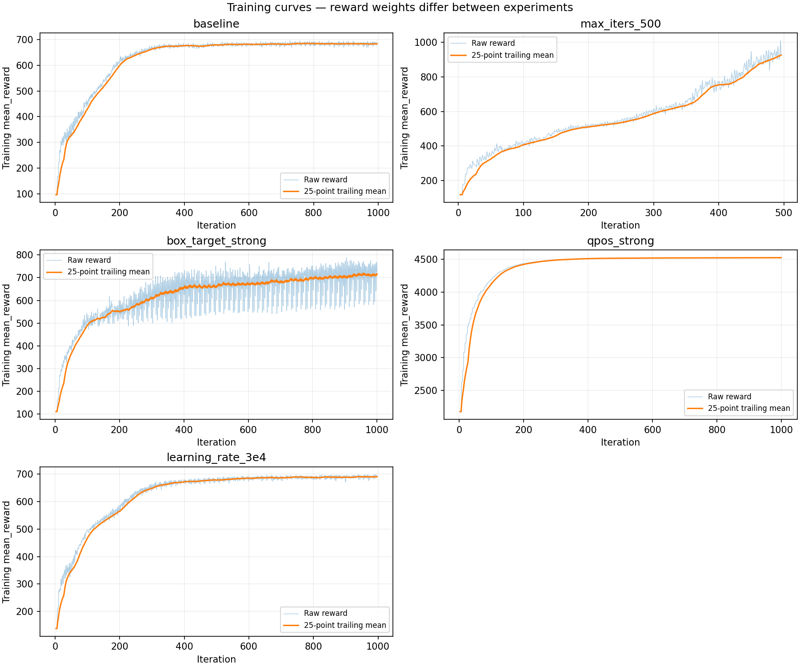

# Сравнение результатов экспериментов — урок 6

Во всех опытах 512 параллельных сред. Baseline — исходная точка с уменьшенным относительно дефолта GPU-масштабом. Инференс: 10 эпизодов, стандартные условия, успех — расстояние от куба до цели меньше 0.05 м в конце эпизода. Числа получены из вывода Colab и итогов инференса пользователя.

| Эксперимент | Изменение относительно baseline | Команда обучения | mean_reward обучения | SR | Δ mean_reward | Δ SR | Время | Наблюдения |
|---|---|---|---:|---:|---:|---:|---:|---|
| baseline | `EXP_NAME="baseline"`, `NUM_ENVS=512`, `MAX_ITERS=1001` | Colab, CLI нет | 678.38 | 0/10 | — | — | 1114 с | Успешных доставок не наблюдалось; подробное визуальное описание отсутствует |
| max_iters_500 | `MAX_ITERS=500`, `EXP_NAME="max_iters_500"` | Colab, CLI нет | 942.06 | 3/10 | +263.68 (+38.9%) | +30 п.п. | 656 с | По счётчикам куб поднимался во всех эпизодах, три доставки успешны |
| box_target_strong | `env_cfg.reward_config.scales.box_target = 40.0`, `EXP_NAME="box_target_strong"` | Colab, CLI нет | 726.13 | 0/10 | +47.75 (+7.0%)* | 0 п.п. | 1156 с | Успешных доставок и подъёмов по счётчикам не было; точное визуальное поведение не зафиксировано |
| qpos_strong | `env_cfg.reward_config.scales.robot_target_qpos = 30.0`, `EXP_NAME="qpos_strong"` | Colab, CLI нет | 4526.54 | 0/10 | +3848.16 (+567.3%)* | 0 п.п. | 1055 с | По наблюдению пользователя рука осталась в стартовой позе |
| learning_rate_3e4 | Начальный `learning_rate=0.0003`, остальное baseline | Colab, CLI нет | 673.91 | 0/10 | −4.47 (−0.66%) | 0 п.п. | 1122 с | По счётчикам успешных доставок не было; визуальное поведение не описано |

\* При изменении награды изменилась её шкала. Эти разницы описывают числа в логах, а не универсальный прирост качества. SR имеет одинаковое определение для всех опытов.

## Изменение масштаба

Изменили только число итераций с 1001 до 500. Ожидали сокращение времени, возможное снижение или сохранение награды; SR мог остаться прежним. Получили награду 942.06, SR 3/10 и сокращение времени на 458 с (41.1%). Награда и SR изменились согласованно вверх, что отличается от типичного примера снижения качества в уроке. Отдельные независимые обучения могут находить разные стратегии; это не доказывает, что уменьшение итераций причинно улучшает качество.

Кривая baseline стабилизируется примерно после 300-й итерации, без успешной доставки. Кривая max_iters_500 продолжает расти к концу, с заметным шумом. По одному такому сравнению нельзя определить оптимальное число итераций для всех запусков.

## Усиление основной компоненты

Изменили только box_target с 8.0 до 40.0. Ожидали рост абсолютной награды и возможное улучшение SR. Награда выросла до 726.13, но SR остался без улучшения. По кривой сохраняются сильные колебания. Увеличение компоненты переноса не гарантировало освоения предыдущей фазы захвата; по одному итогу точную причину установить нельзя. Гипотеза подтвердилась по числу награды, но улучшение реальной задачи не наблюдалось.

## Усиление вспомогательной компоненты

Изменили только robot_target_qpos с 0.3 до 30.0. Ожидали высокую награду за сохранение позы и отсутствие доставки. Награда 4526.54, SR 0/10; рука оставалась в стартовой позе. Кривая быстро выходит на высокое плато и затем почти не меняется. В этом опыте гипотеза подтверждена: оптимизатор нашёл выгодное поведение для заданной функции награды, которое не выполняет задачу PickCube.

В наших данных по SR лучше остальных оказался max_iters_500. Нельзя повторять пример курса о падении SR у qpos_strong относительно baseline: у нашего baseline SR уже был нулевым. Различие qpos_strong видно по поведению и большой награде при отсутствии доставки.

## Самостоятельный опыт: начальный learning_rate

Изменили только начальный learning_rate с 0.001 до 0.0003 при сохранении адаптивного расписания. Гипотеза до запуска: награда останется близкой к baseline либо снизится, SR может не улучшиться. Получили mean_reward обучения 673.91 против 678.38 (−4.47, −0.66%), время 1122 с против 1114 с. Инференс: SR 0/10, средняя награда 691.71; условия проверки прежние, без видео. По reward и SR результат согласуется с гипотезой. Уменьшение начального шага не дало наблюдаемого улучшения доставки. Адаптивное расписание могло менять learning_rate по ходу обучения; вывод о постоянном меньшем шаге делать нельзя. Один запуск и 10 эпизодов не позволяют считать отсутствие эффекта доказанным для других запусков.

## Источник кривых и ограничения

Кривые и CSV learning-curves.csv извлечены из локальных TensorBoard events; исходные файлы не изменялись. Скрипт plot_learning.py сверяет совпадающие точки с округлённым выводом Colab. Сглаживание — скользящее среднее по 25 точкам.

В некоторых event-файлах последние записи не успели полностью сохраниться при завершении процесса: baseline заканчивается на шаге 996, max_iters_500 — на 496, qpos_strong — на 999, learning_rate_3e4 — на 997; box_target_strong — на 1000. Неполные хвостовые записи пропущены. Финальные значения таблицы взяты из завершающего вывода обучения, а не подменены последней доступной точкой events.

Награда инференса рассчитывается в inference.py со стандартными весами среды, которые не восстанавливаются из reward-настроек обучения. Поэтому она не заменяет mean_reward обучения; сравнивать эти два числа как одну метрику нельзя.
