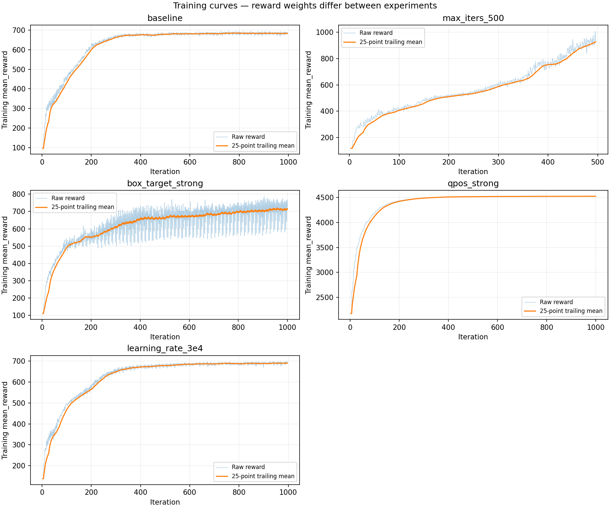

# Отчёт по практике 2 Physical AI

## 1. Поиск параметров

| Параметр | Файл / способ доступа | Имя ключа / флага | Значение по умолчанию |
|---|---|---|---|
| num_envs | `train.py`: `parse_args()`; `device_utils.py`: `default_num_envs()` | `--num_envs` | 4096 на CUDA, 64 на CPU/MPS |
| learning_rate | `config.py`: `manipulation_params.rsl_rl_config("PandaPickCube").to_dict()` | `cfg_dict["algorithm"]["learning_rate"]` | 0.001 |
| max_iters | `train.py`: `parse_args()` | `--max_iters` | 1001 |
| gripper_box | `registry.get_default_config("PandaPickCube")`; переопределение перед `registry.load(...)` | `env_cfg.reward_config.scales.gripper_box` | 4.0 |

`num_envs` задаёт число параллельных сред сбора опыта; `max_iters` — число итераций обучения; `learning_rate` — начальный шаг обновления PPO; `gripper_box` — вес компоненты награды за приближение захвата к кубу.

## 2. Условия экспериментов

Среда — PandaPickCube. Обучение выполнялось с нуля в Colab на GPU T4, инференс — на CPU, по 10 эпизодов. Во всех опытах `NUM_ENVS=512`, `SEED=1`, сохранение каждые 50 итераций. Число сред уменьшено с дефолтных 4096 до 512; baseline и все сравнения относятся к этому масштабу. Остальные параметры сохранялись относительно baseline, кроме единственного изменения в каждом опыте.

SR — число эпизодов, в которых расстояние от куба до цели в конце эпизода меньше 0.05 м. `mean_reward` взят с последней итерации обучения. Колонка «Команда запуска» оставлена пустой по шаблону курса для Colab.

## 3. Сводная таблица четырёх запусков

| Эксперимент | Изменения в коде | Команда запуска | mean_reward | SR (k/10) | Δ mean_reward | Δ SR | Время обучения | Поведение |
|---|---|---|---:|---:|---:|---:|---:|---|
| baseline | `EXP_NAME = "baseline"`; `NUM_ENVS = 512`; `MAX_ITERS = 1001` | | 678.38 | 0/10 | — | — | 1114 с | Рука подходила к кубу; подъём и доставка не зафиксированы. |
| max_iters_500 | `EXP_NAME = "max_iters_500"`; `MAX_ITERS = 500` вместо 1001 | | 942.06 | 3/10 | +263.68 (+38.87%) | +30 п.п. | 656 с | Куб поднимался во всех 10 эпизодах; в трёх доставлен к цели. |
| box_target_strong | `EXP_NAME = "box_target_strong"`; `env_cfg.reward_config.scales.box_target = 40.0` вместо 8.0 | | 726.13 | 0/10 | +47.75 (+7.04%) | 0 п.п. | 1156 с | Рука подходила к кубу; подъём и доставка не зафиксированы. |
| qpos_strong | `EXP_NAME = "qpos_strong"`; `env_cfg.reward_config.scales.robot_target_qpos = 30.0` вместо 0.3 | | 4526.54 | 0/10 | +3848.16 (+567.26%) | 0 п.п. | 1055 с | Робот оставался в стартовой позе, куб не поднимал. |

Δ рассчитаны относительно baseline. В опытах с изменёнными весами награды изменилась шкала `mean_reward`: рост этого числа сам по себе не означает улучшение доставки.

## 4. Сравнение кривых и интерпретация

На графике показаны награда по итерациям и скользящее среднее по 25 точкам.

| Эксперимент | Форма кривой |
|---|---|
| baseline | Рост в начале, затем плато примерно после 300-й итерации с колебаниями около 680. |
| max_iters_500 | Рост продолжается к завершению обучения; заметны колебания. |
| box_target_strong | Награда колеблется, сохраняется слабый рост; успешная доставка не освоена. |
| qpos_strong | Быстрый выход на высокое плато около 4526, затем малые колебания. |
| learning_rate_3e4 | Выход на уровень, близкий к baseline; в конце награда колеблется около 690. |

**Масштаб.** До запуска ожидалось сокращение времени примерно вдвое, награда ниже или близко к baseline, без улучшения SR. При уменьшении `max_iters` с 1001 до 500 время сократилось на 458 с (41.11%), однако награда выросла на 263.68, а SR — с 0/10 до 3/10. Гипотеза подтвердилась по времени, но не по качеству. Обе метрики качества выросли согласованно; отдельные обучения могли найти разные стратегии, поэтому этот результат не доказывает общего преимущества меньшего числа итераций.

**Основная компонента награды.** Для `box_target_strong` ожидался рост абсолютной награды и возможное улучшение SR. Награда выросла на 7.04%, но SR остался 0/10. Усиление веса близости куба к цели изменило приоритет оптимизации, однако не обеспечило освоение подъёма и доставки.

**Вспомогательная компонента награды.** Для `qpos_strong` ожидалась высокая награда за сохранение позы без доставки. Получены `mean_reward=4526.54` и SR 0/10; робот оставался в стартовой позе. Это согласуется с гипотезой: доминирующее поощрение целевых углов суставов вытеснило задачу переноса куба.

**Сравнительный вывод.** По SR наибольшее улучшение дала модификация масштаба: +30 п.п., тогда как обе модификации награды сохранили нулевой SR. По численному приросту `mean_reward` сильнее всего выделился `qpos_strong`, но в нём изменена сама функция награды. Поэтому для оценки выполнения PickCube выбран SR. В отличие от изменения масштаба, изменение веса основной компоненты меняет приоритет задачи, а сильное усиление вспомогательной — может подменить её удобным для оптимизатора поведением. Следовательно, высокий reward необходимо интерпретировать вместе с SR и наблюдаемым поведением.

## 5. Самостоятельный эксперимент: learning_rate_3e4

**Исследовательский вопрос:** как уменьшение начального `learning_rate` PPO влияет на обучение и доставку куба при 512 средах?

### Гипотеза до запуска

| Поле | Формулировка |
|---|---|
| Параметр | `cfg_dict["algorithm"]["learning_rate"]` в конфиге PPO, после `build_runner_cfg(...)` и до создания `OnPolicyRunner`. |
| Изменение | `cfg_dict["algorithm"]["learning_rate"] = 0.0003` вместо 0.001. |
| Ожидание по mean_reward | Значение близко к baseline либо ниже. |
| Ожидание по SR | Может остаться без улучшения относительно baseline. |
| Обоснование | Если уменьшить начальный шаг обновления PPO, начальные изменения весов будут меньше. При фиксированном бюджете итераций это может замедлить освоение стратегии. |

### Результат и проверка гипотезы

| Эксперимент | Изменения в коде | Команда запуска | mean_reward | SR (k/10) | Δ mean_reward | Δ SR | Время обучения | Поведение |
|---|---|---|---:|---:|---:|---:|---:|---|
| learning_rate_3e4 | `EXP_NAME = "learning_rate_3e4"`; `cfg_dict["algorithm"]["learning_rate"] = 0.0003` | | 673.91 | 0/10 | −4.47 (−0.66%) | 0 п.п. | 1122 с | Рука подходила к кубу; подъём и доставка не зафиксированы. |

- **Подтверждение по mean_reward: да.** Награда на 0.66% ниже baseline и остаётся близкой к нему.
- **Подтверждение по SR: да.** Улучшения не наблюдалось: SR сохранился на уровне 0/10.
- **Согласованность метрик:** награда почти не изменилась, успешность осталась прежней; противоположных изменений нет.
- **Объяснение:** меньшее начальное обновление не привело к освоению доставки за 1001 итерацию. При этом сохранено адаптивное расписание `schedule="adaptive"`, поэтому learning rate мог изменяться по ходу обучения. Один запуск и 10 эпизодов не позволяют установить общий эффект параметра.
- **Практический вывод:** в проверенных условиях уменьшение начального learning rate до 0.0003 не улучшило выполнение задачи.
